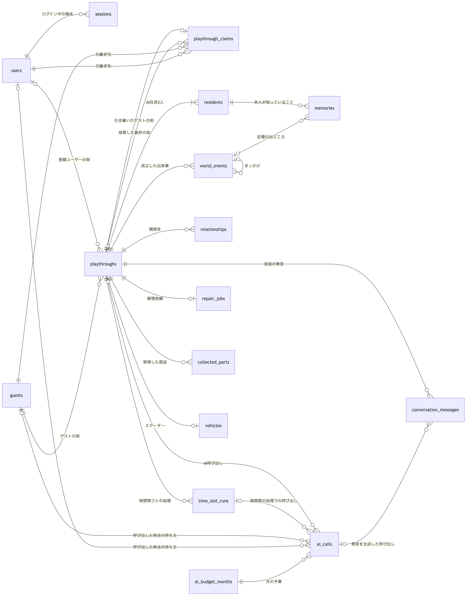
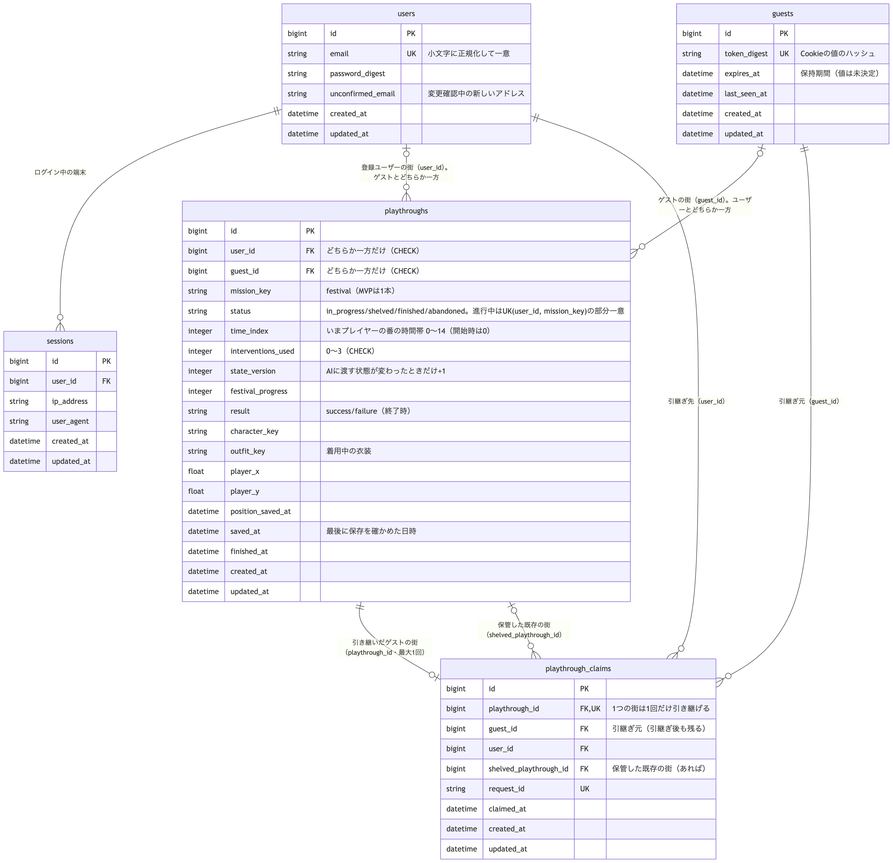
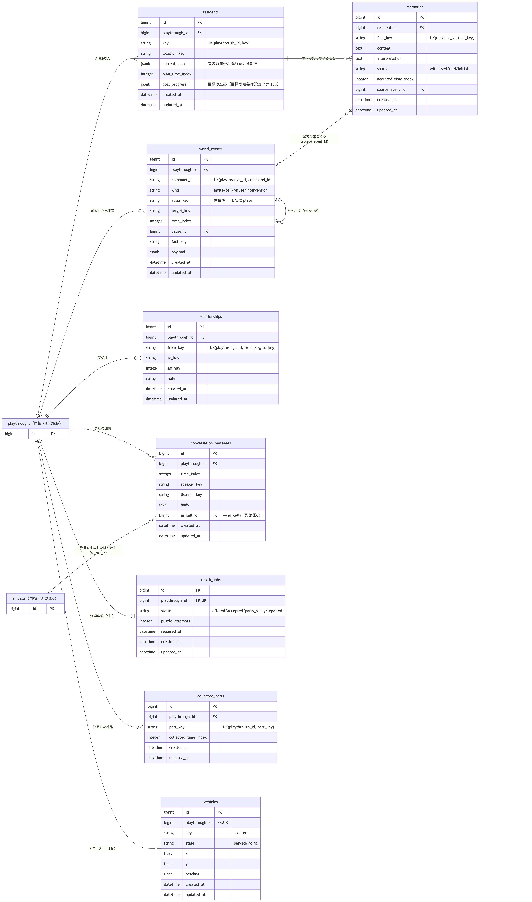
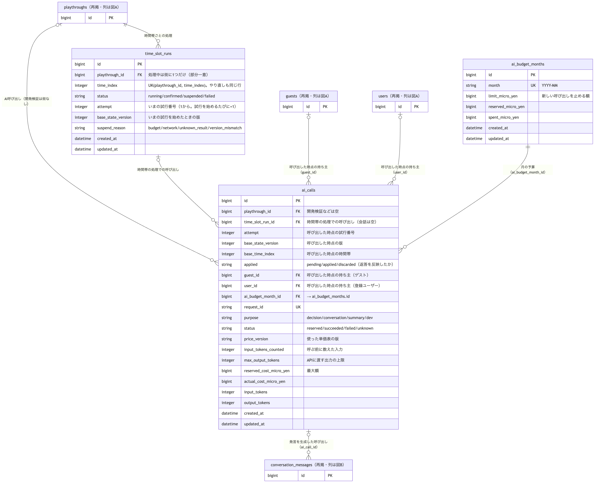
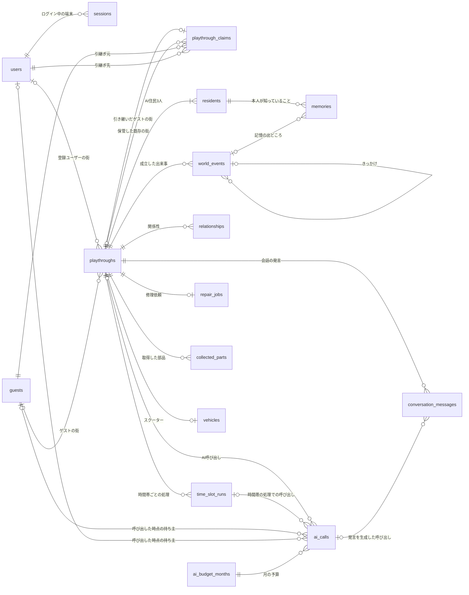
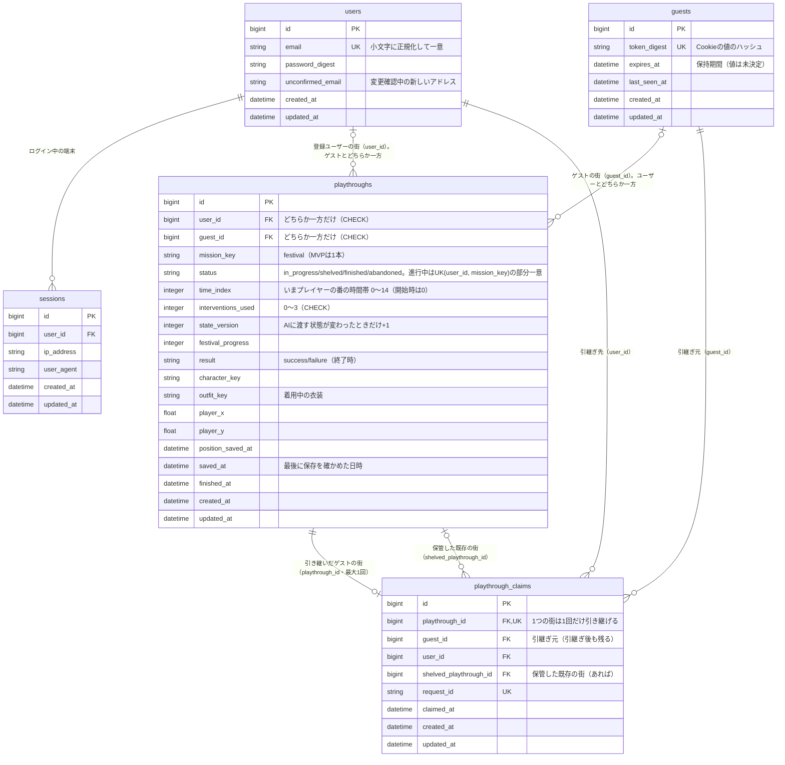
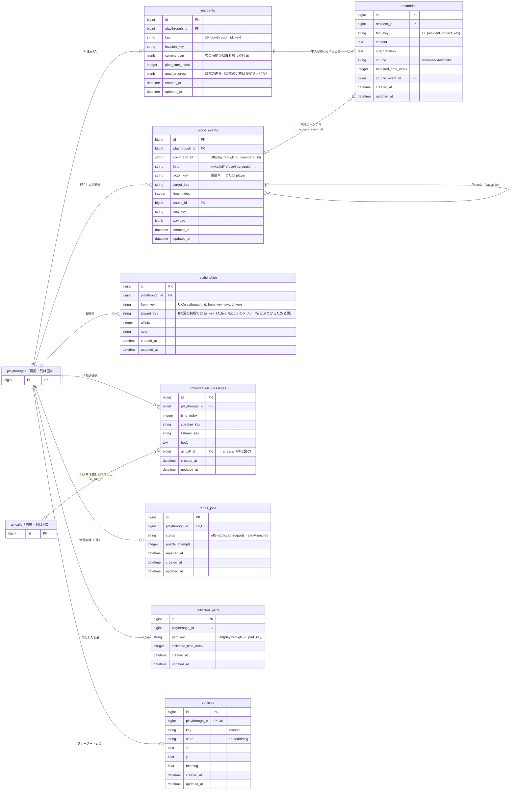
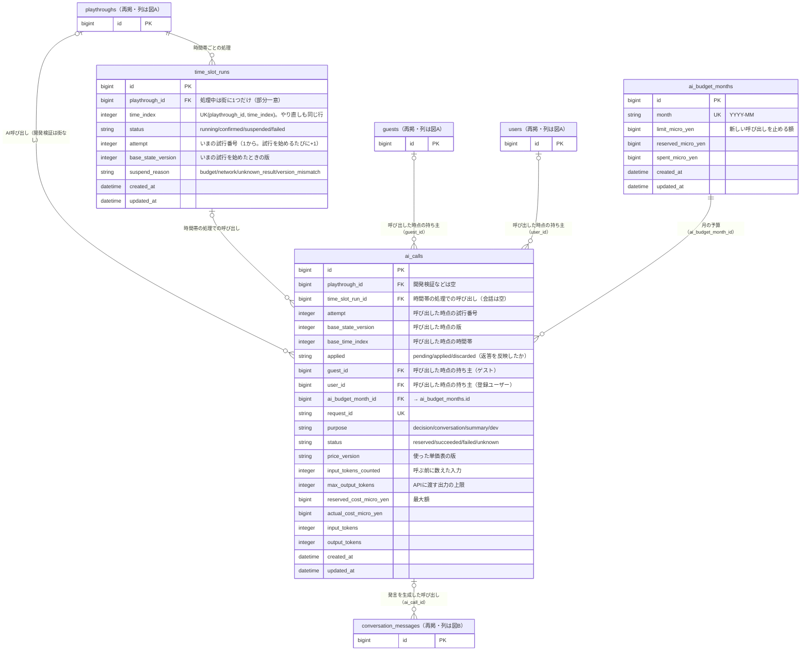

# Butterfly Town ER図

MVP（README「7-2. MVPの完成範囲」）で使うテーブルの設計です。全体図1枚と詳細図3枚に分けています。画像をクリックすると原寸で開きます。

| 図 | 内容 | 画像 |
| --- | --- | --- |
| 全体図 | 16テーブルと関連線（列は載せない） | [er-overview.png](er/er-overview.png) |
| 図A アカウントと引継ぎ | `users`・`sessions`・`guests`・`playthroughs`・`playthrough_claims` | [er-A.png](er/er-A.png) |
| 図B 街の中身 | `residents`・`memories`・`world_events`・`relationships`・`conversation_messages`・`repair_jobs`・`collected_parts`・`vehicles` | [er-B.png](er/er-B.png) |
| 図C 時間帯とAI予算 | `time_slot_runs`・`ai_calls`・`ai_budget_months` | [er-C.png](er/er-C.png) |

図の読み方：

- 各テーブルの列は、どれか1枚の詳細図にだけ載せています。ほかの図に出てくるときは「（再掲・列は図X）」と書き、`id` だけを載せています。
- 別の図にあるテーブルを指す外部キーは、列の注記に「→ テーブル名（列は図X）」と書いています。
- `UK` は一意制約です。複数列や条件つきの一意制約は、列の注記に書いています。
- `created_at`・`updated_at` はすべてのテーブルに持たせます。`saved_at`・`claimed_at` など用途のある日時は別の列です。

## 全体図

## 図A アカウントと引継ぎ

## 図B 街の中身

## 図C 時間帯とAI予算

## テーブルの役割

| テーブル | 役割 |
| --- | --- |
| `users` | 登録ユーザー。メールアドレスとパスワードでログインする |
| `sessions` | ログイン中の端末 |
| `guests` | 登録不要のゲスト。Cookie の値はハッシュだけを保存する |
| `playthroughs` | 1回のプレイ（街）。セーブの単位。ゲストの街も登録ユーザーの街もここに置く |
| `playthrough_claims` | ゲストの街を登録ユーザーへ引き継いだ記録。引継ぎ後も元のゲストを残す |
| `residents` | 街ごとのAI住民3人。いる場所・計画・目標の進捗 |
| `memories` | 住民ごとの知識・記憶。AIに渡すのは、その住民の行だけ |
| `world_events` | 実際に成立した出来事（誘う・伝える・断る・特殊介入など） |
| `relationships` | 住民どうし・住民とプレイヤーの関係。結果画面の振り返りに使う |
| `conversation_messages` | 通常会話の発言。発言そのものは出来事として扱わない |
| `time_slot_runs` | 時間帯ごとのAI処理。1つの街の1つの時間帯につき1行 |
| `repair_jobs` | バイク屋の修理依頼（1つの街に1件） |
| `collected_parts` | 取得した部品 |
| `vehicles` | 修理で手に入れたスクーター（1つの街に1台）。行があること＝解放済み。状態・位置・向き |
| `ai_calls` | AI呼び出し1回ごとの記録。呼ぶ前に最大額を予約し、応答後に精算する |
| `ai_budget_months` | 月ごとのAI予算 |

住民の人格・目標の定義・初期の記憶、衣装・部品の一覧、ミッションの条件、地図、AIの単価表は、テーブルではなく設定ファイル（`backend/config/`）に置きます。DBには設定ファイルのキーを文字列で保存します。住民・車両そのものの設定キーは `residents.key`・`vehicles.key`、別の対象を指すキーは `mission_key`・`part_key` のように対象名を付けます。

## 図だけでは伝わらない決まり

### 街の持ち主は、ユーザーかゲストのどちらか一方

- `playthroughs` の CHECK 制約：`(user_id IS NULL) <> (guest_id IS NULL)`。両方が空、両方が入っている、のどちらも DB が拒否します。
- `ai_calls` の `user_id`・`guest_id` には、呼び出した時点の持ち主を入れます。引継ぎの後も、引継ぎ前の呼び出しはゲストの利用として数えられます。

### 一意制約

| 対象 | 制約 |
| --- | --- |
| `users.email` | 小文字に正規化して一意 |
| `guests.token_digest` | 一意 |
| `playthroughs(user_id, mission_key)` | `status = 'in_progress'` の行だけを対象にした部分一意インデックス。同じミッションの進行中の街は1ユーザーに1つ |
| `playthroughs(guest_id, mission_key)` | 同じく `status = 'in_progress'` の行だけを対象にした部分一意インデックス。ゲストも同じミッションの進行中の街は1つ（#7 で追加。開始が同時に届いても街を2つ作らない） |
| `playthrough_claims.playthrough_id` | 一意。1つの街は1回だけ引き継げる |
| `playthrough_claims.request_id` | 一意。同じ引継ぎの再送を見分ける |
| `time_slot_runs(playthrough_id, time_index)` | 一意。やり直しても行を増やさない |
| `time_slot_runs(playthrough_id)` | `status = 'running'` の行だけを対象にした部分一意インデックス。処理中の時間帯は街に1つだけ |
| `ai_calls(playthrough_id)` | `purpose = 'conversation'` かつ `applied = 'pending'` の行だけを対象にした部分一意インデックス。返答待ちの会話は街に1つだけ |
| `ai_calls.request_id` | 一意 |
| `ai_budget_months.month` | 一意（`YYYY-MM`） |
| `residents(playthrough_id, key)`、`memories(resident_id, fact_key)`、`world_events(playthrough_id, command_id)`、`relationships(playthrough_id, from_key, toward_key)`、`collected_parts(playthrough_id, part_key)` | 一意。同じ住民・同じ記憶・同じ出来事などを二重に作らない |
| `repair_jobs.playthrough_id`、`vehicles.playthrough_id` | 一意。1つの街に1件・1台 |

### ゲストから登録への引継ぎは、全部反映するか何も反映しないか

- 登録・ログインしたユーザーに進行中の街がなければ、ゲストの街の持ち主をユーザーに付け替えます。
- 進行中の街がある場合は、確認画面（S24）で本人が選ぶまで、どちらの街も変えません。ゲストの街を選んだときは、次の3つを**1つのトランザクション**で行います。途中で失敗したら、すべて取り消します。
  1. 既存の街を `shelved`（保管）にする。中身には触らない。
  2. ゲストの街の持ち主をユーザーに付け替える。
  3. `playthrough_claims` に記録する。
- 関係する街の行は、`id` の小さい順にロック（`SELECT … FOR UPDATE`）します。
- 同じ `request_id` の再送や二度押しには、何も変えずに「引継ぎ済み」を返します。
- 時間帯の処理中と、会話の返答待ちの間は、引継ぎを受け付けません。
- 既存の街は、確認なしに上書き・統合・削除しません。2つの街のデータを混ぜる処理も作りません。

### 時間帯の処理と会話の返答

- `playthroughs.time_index` は、いまプレイヤーの番になっている時間帯（0〜14）です。開始時は0で、確定するたびに1増えます。最後の時間帯を確定すると `finished` になります。
- 時間帯の処理をやり直すときは、同じ行の `attempt` を1増やします。AIの返答は、`attempt` がいまの値と同じで、返答待ち（`applied = pending`）のときだけ反映します。前の試行の遅れた返答では、いまの試行を止めません。
- `state_version` は、AIに渡す状態が変わったときだけ増やします。AIの案は、作ったときの版と反映するときの版が同じときだけ反映します。
- 会話の返答も、返答待ちのもので、会話を始めたときの時間帯・版と同じときだけ反映します。

### AIの予算

- 金額は「100万分の1円」の整数で、`bigint` で持ちます。
- 呼ぶ前に、その呼び出しで起こり得る最大額を `ai_budget_months` に予約します。上限を超える呼び出しはしません。
- 結果が分からない呼び出し（タイムアウトなど）は、予約額の全額を使ったものとして数え、自動では呼び直しません。
- 月の行は「使った額＋予約中の額＋今回の最大額」が `limit_micro_yen`（新しい呼び出しを止める額、月2,000円）を超えないときだけ予約します。月の区切りは日本時間（毎月1日 0:00）です。
- `ai_calls.user_id` の外部キーは、`users` を作るとき（#16）に足します。

## 未決定のこと

図は次の置き方で描いています。値や方式が決まったら、図とこの文書を直します。

| 項目 | 図での置き方 |
| --- | --- |
| ゲストの保持期間 | `guests.expires_at` を持つ。期間の値は未決定 |
| ゲストのAI利用制限 | `ai_calls.guest_id` で回数・金額を数えられる形にした。制限の値は未決定 |
| 保存枠の数 | 同じミッションの進行中の街は1ユーザーに1つ。保管した街の数は制限しない |
| 保管した街の再開・削除 | `status = shelved` で残す。再開の画面と削除は未決定 |
| 衣装の解放 | 解放の表は作らず、着用中の衣装（`outfit_key`）だけを保存する。解放の方式は未決定 |
| 関係性の持ち方 | 値（`affinity`）とひとこと（`note`）。振り返り画面の内容が決まったら見直す |
| メールアドレス変更の確認 | `unconfirmed_email` に入れ、確認後に `email` へ移す |
| AI呼び出しの自動再試行の上限 | 未決定 |
| 予約額に使う為替の値 | 暫定値の1ドル150円で計算する（2026-11-13）。見直す時期・条件は未決定 |
| 請求の月とのずれ | こちらの月は日本時間、Anthropic の請求の月は UTC で、9時間ずれる。月をまたぐ9時間に使った分は、台帳と請求で別の月に入る。約1,000円の予備で吸収できるかは未確認 |

## 編集用Mermaid

画像は下の Mermaid から作っています（mermaid-cli、2倍の解像度）。図を直すときは、ここを直してから画像を作り直します。

### 全体図（テーブルと関連線）

### 図A アカウントと引継ぎ

### 図B 街の中身

### 図C 時間帯とAI予算

